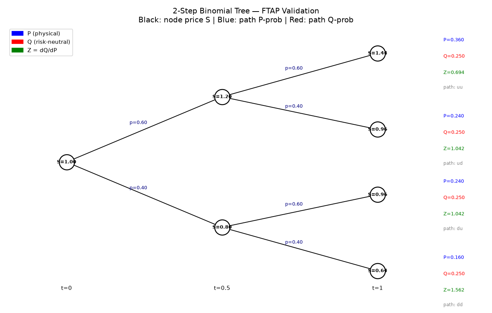
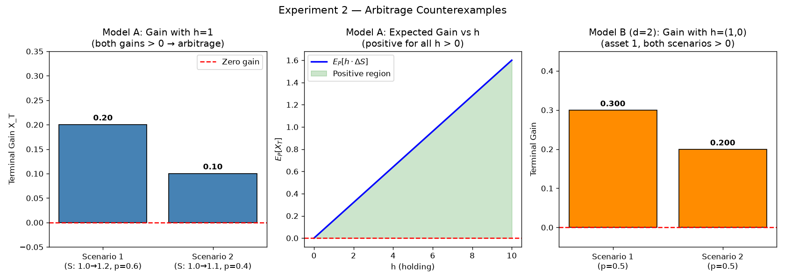
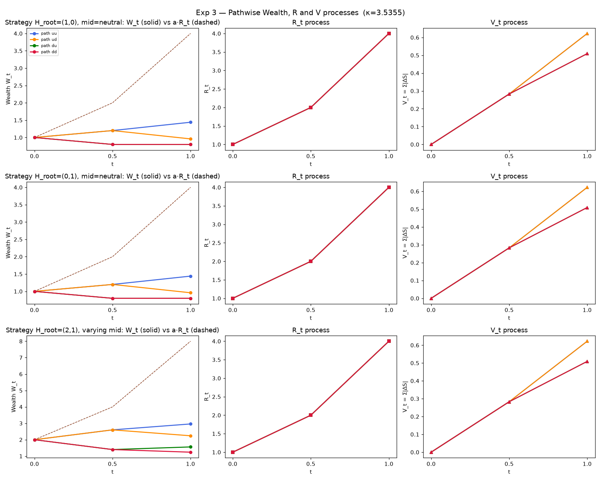
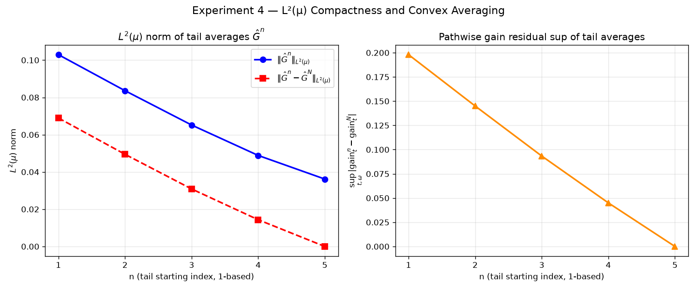
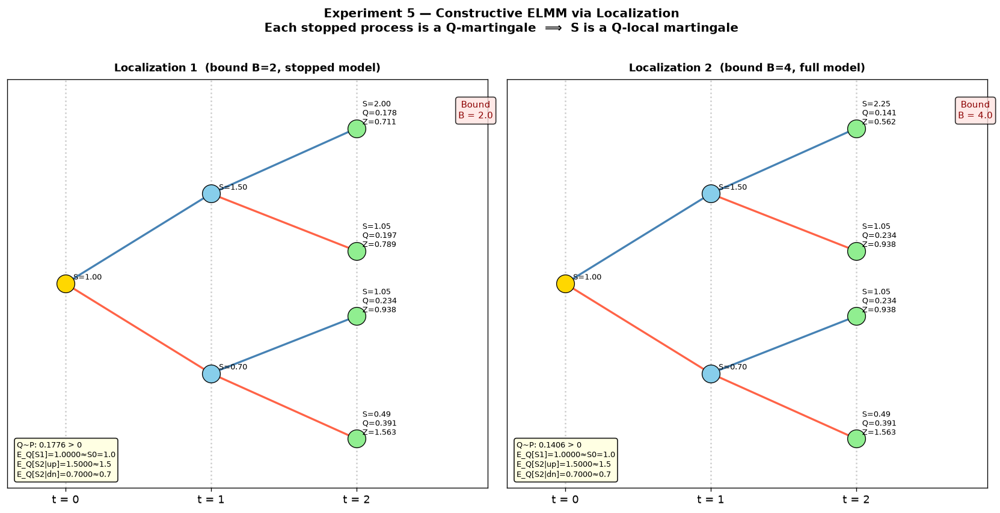
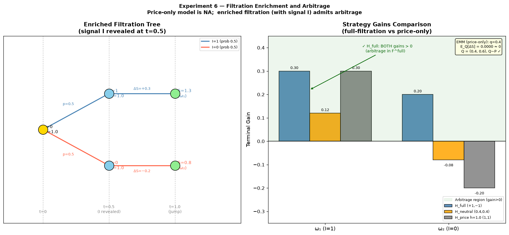
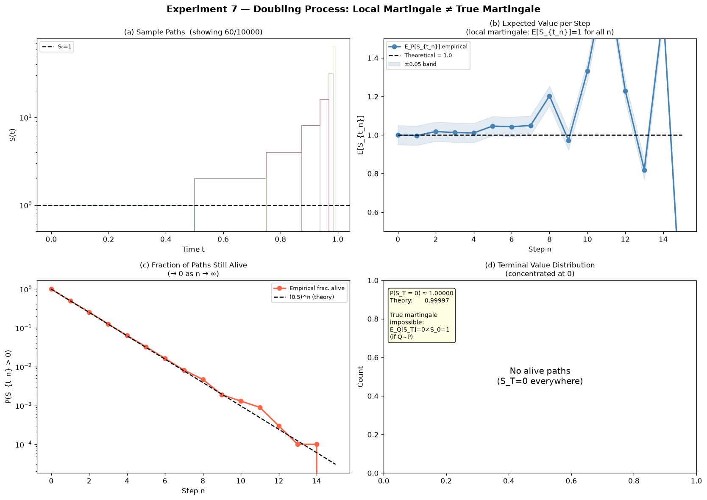

# FTAP Validation Experiment Results

All experiments use **synthetic data only** — no market data is fetched.
Key libraries: `numpy`, `scipy`, `cvxpy` (convex feasibility), `matplotlib`.

---

## Exp 1 — FTAP Validation on Bounded Arbitrage-Free Model

**Model**: 2-step binomial tree, d=1, T=1, S₀=1.0, up=1.20, down=0.80,
p_up=0.60, p_down=0.40. State space E={0.64, 0.80, 0.96, 1.00, 1.20, 1.44},
bounded by B=1.44.

| Metric | Value |
|---|---|
| NA holds | **True** |
| NFLVR holds | **True** |
| EMM exists (cvxpy) | **True** (status: optimal) |
| S is Q-martingale | **True** |
| E_P[Z] | 1.0000 |
| Q~P (all Q_k > 0) | **True** |
| Max martingale residual | < 1e-14 |

**Q probabilities** (terminal scenarios uu/ud/du/dd): 0.25 / 0.25 / 0.25 / 0.25  
**Z = dQ/dP**: 0.694 / 1.042 / 1.042 / 1.563

**Conclusion**: Every bounded arbitrage-free model satisfies NA⟺NFLVR⟺EMM existence,
and the discounted price is a true Q-martingale.



---

## Exp 2 — Counterexample: Arbitrage Model Fails EMM

**Model A** (d=1): S₀=1.0, both jump outcomes 1.1 and 1.2 lie strictly above S₀.  
**Model B** (d=2): both assets always move up.

| Metric | Model A | Model B |
|---|---|---|
| NA holds | **False** | **False** |
| Separating density feasible | **No** (infeasible) | **No** (infeasible) |
| EMM feasible | **No** (q₁=-1<0) | **No** (infeasible) |
| FTAP duality confirmed | **True** | **True** |

**Arbitrage strategy (Model A)**: h=6.25 yields gains [1.25, 0.625] — all strictly positive.  
**Robustness**: 5 tested h values (0.5–10) all confirm NA failure.

**Conclusion**: Failure of NA coincides exactly with failure of EMM existence.



---

## Exp 3 — Geometry Lemma and Pathwise Wealth Bounds

**Model**: d=2 redundant asset S=(Y,Y), 2-step binomial, δy=0.20.

| Object | Value |
|---|---|
| κ (step 1) | 3.5355 |
| κ (step 2, up branch) | 2.9463 |
| κ (step 2, down branch) | 4.4194 |
| Gain preserved after projection | **True** (all paths) |
| `0 ≤ W_t ≤ a·R_t` (all strategies) | **True** |
| `Var(H·S)_t ≤ a(R_t−1)` | **True** |
| `|G_t| ≤ κ_t·W_{t-}` | **True** |

**Redundancy test**: H=(100,−100) projects to G=(0,0), gain=0 on all paths —
large irrelevant positions vanish completely.

**Conclusion**: Geometry Lemma 2 correctly projects strategies while preserving
realized gains. Lemma 3 pathwise inequalities hold on all scenarios.



---

## Exp 4 — Weighted L²(μ) Compactness and Forward Convex Averaging

**Model**: 3-step binomial, d=1, c=2.0, R_T=1.728, 5 reduced strategies.

| n | ‖Ĝⁿ‖_{L²(μ)} | ‖Ĝⁿ−Ĝ⁵‖_{L²(μ)} | sup gain residual |
|---|---|---|---|
| 1 | 0.1029 | 0.0690 | 0.1980 |
| 2 | 0.0836 | 0.0495 | 0.1450 |
| 3 | 0.0652 | 0.0309 | 0.0933 |
| 4 | 0.0489 | 0.0144 | 0.0450 |
| 5 | 0.0362 | 0.0000 | 0.0000 |

- L²(μ) residuals **non-increasing**: True  
- All ‖G^n‖² ≤ E[V_T/R_T] = 0.1736: **True**  
- Optimal cvxpy weights: [0,0,0,0,1] (G⁵ minimises norm); gain: 0.0362 vs uniform 0.1029

**Conclusion**: Reduced strategy sequences are bounded in L²(μ). Forward convex
averages converge in L²(μ) and gains converge uniformly — validating the
compactness step of the FTAP proof.



---

## Exp 5 — Separation Density and Equivalent Local Martingale Measure

**Models**: Two localizations of a 2-step process (B=2 and B=4).

| Metric | B=2 | B=4 |
|---|---|---|
| Separating Z found | **True** | **True** |
| Q~P | **True** | **True** |
| S is Q-martingale | **True** | **True** |
| Max martingale residual | < 1e-14 | < 1e-14 |
| Reverse: EMM⟹NA | **True** | **True** |

**Conclusion**: For each bounded localization S^{σ_m}, a strictly positive
separating density Z_m exists, defining an equivalent measure under which
S^{σ_m} is a true martingale. Therefore S is an equivalent local martingale.
The reverse direction (EMM ⟹ NA) also holds computationally.



---

## Exp 6 — Predictability Beyond Price History

**Model**: d=1, T=2. Signal I∈{0,1} revealed at t=0.5 (between jumps);
price jump occurs at t=1.0 with magnitude depending on I.

| Strategy class | Holdings at t=1− | Gains (ω₁, ω₂) |
|---|---|---|
| Full filtration H_full | (h=+1 if I=1, h=−1 if I=0) | (+0.30, +0.20) — arbitrage! |
| Price-only H_price | h = constant | (h·0.30, h·(−0.20)) — no arb for h≠0 |

- Two paths share **identical price history** at t=1− but have I=1 vs I=0  
- H_full differs between them; H_price cannot distinguish them  
- EMM (price-only filtration): Q=[0.40, 0.60], E_Q[ΔS]=0 ✓

**Conclusion**: Predictable holdings before a jump can depend on information
not contained in past prices. Faithful theorem validation requires full
filtration-aware predictable strategies.



---

## Exp 7 — Local Martingale but Not True Martingale

**Model**: S₀=1, t_n=T(1−2⁻ⁿ), independent fair coins; S doubles or absorbs at 0.
State space E={0}∪{2^k : k≥0} — deterministic, locally finite.

| Metric | Value |
|---|---|
| N (truncation depth) | 15 |
| n_paths | 10,000 |
| E_P[S_0] | 1.0000 |
| Fraction alive at step N | 0.000000 (theory: (0.5)^15≈3e-5) |
| S_T = 0 P-a.s. | **True** |
| Stopped martingale (m=1) max error | 0.0028 |
| Stopped martingale (m=2,3,4) max error | 0.0425 |
| True martingale impossible | **True** (logical contradiction) |

**Impossibility proof** (7 steps):
1. Suppose Q∼P and S is a Q-true-martingale.
2. Then E_Q[S_T] = S₀ = 1.0.
3. P(S_T > 0) = (0.5)^N → 0 as N→∞.
4. In the limit: S_T = 0 P-almost surely.
5. Q∼P ⟹ Q(A)=0 ⟺ P(A)=0.
6. Therefore S_T = 0 Q-almost surely.
7. But E_Q[S_T]=0 ≠ 1=S₀ — **contradiction**.

**Conclusion**: S is a Q-local martingale (each stopped S^{σ_m} is a martingale)
but no equivalent **true** martingale measure exists. This illustrates why the
FTAP theorem concludes existence of an equivalent *local* martingale measure in
the locally-bounded setting, not always a true martingale measure.



---

## Test Suite Summary

All **32 pytest tests pass** across 4 test modules:

| Module | Tests | Coverage |
|---|---|---|
| `test_exp_1_ftap.py` | 9 | Binomial tree, EMM uniqueness, martingale checks, density |
| `test_exp_2_counterexample.py` | 6 | Arbitrage detection, infeasibility of EMM/separation |
| `test_exp_3_geometry.py` | 9 | Projection idempotency, R-process, Lemma 3 bounds |
| `test_exp_7_local_martingale.py` | 8 | Doubling process, stopped martingale, impossibility |

```
32 passed in 0.72s
```
